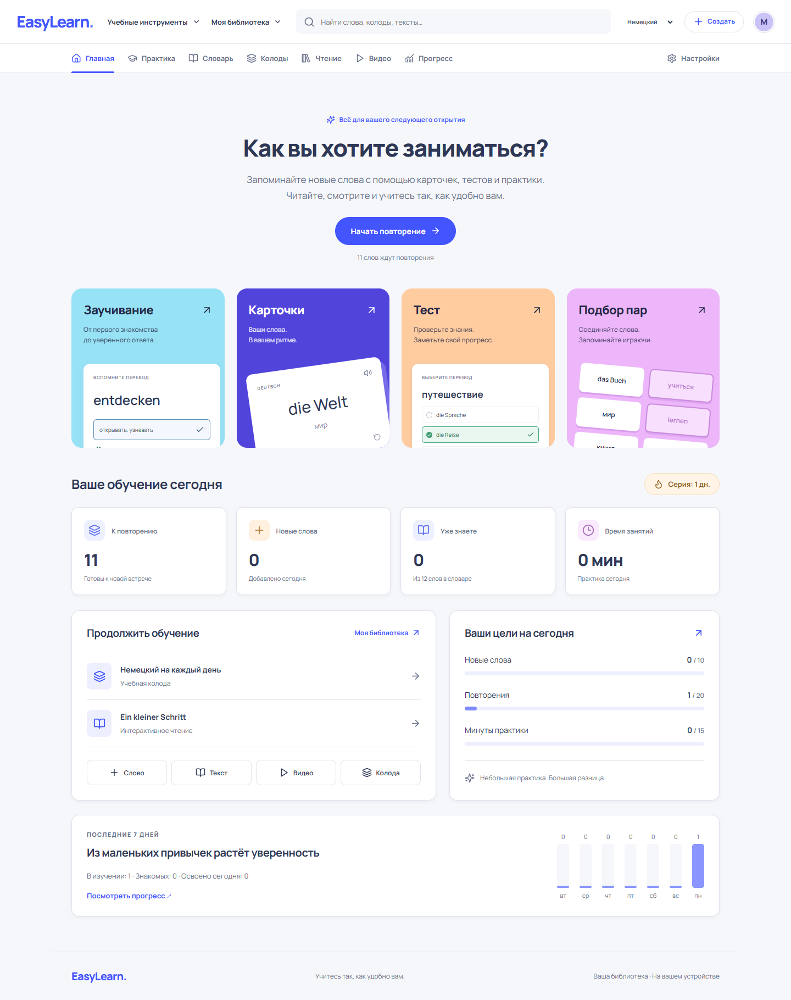
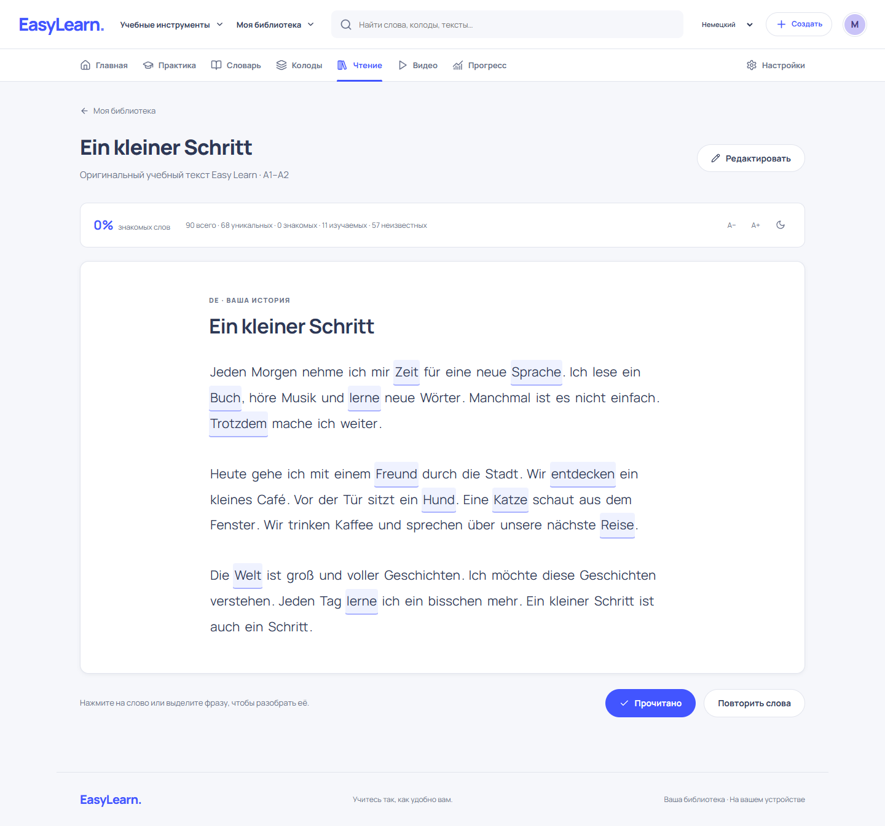
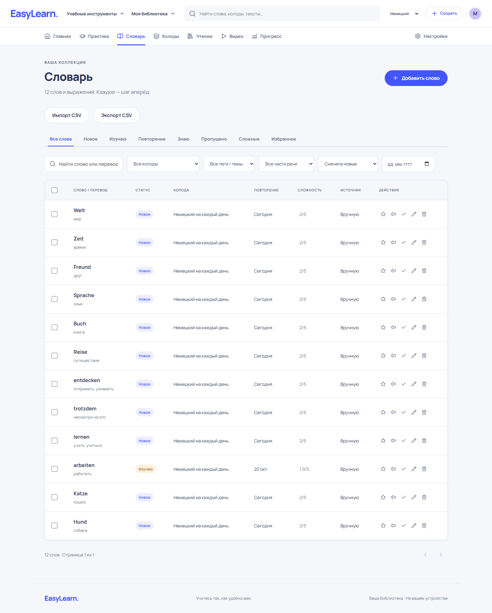

# Easy Learn

Личное пространство для изучения языков: словарь, колоды, карточки, интервальные повторения, чтение и видео. React + TypeScript, без аккаунта и сервера. Контент хранится в IndexedDB на вашем устройстве.

Визуальный стиль обновлён по референсу Quizlet: верхняя навигация, светлый фон, сине-фиолетовые акценты, цветные плитки режимов, крупная типографика и округлые карточки. Оформление едино для всех страниц и обеих тем.



## Запуск

В текущей папке зависимости уже установлены. В Windows запустите **`start-easy-learn.cmd`** и откройте **http://127.0.0.1:5173**. Оставьте окно запуска открытым; Ctrl+C остановит сервер.

Для установки на другом компьютере нужны Node.js 22+ и npm или pnpm:

```sh
npm install
npm run dev
```

В проекте сохранён `pnpm-lock.yaml`. Для воспроизводимой установки: `pnpm install --frozen-lockfile`. Не используйте два менеджера пакетов одновременно.

## Что работает

- Словарь: добавление, подробное редактирование, избранное, статусы, сложность, поиск, сортировка, пагинация, фильтры по колоде, теме/тегу, части речи и дате. Массовое удаление и перемещение; проверка дублей в пределах языка.
- Колоды: создание, редактирование, копирование, удаление, управление составом, прогресс и последнее занятие.
- Практика: двусторонние карточки, озвучивание, перемешивание, полноэкранный режим; ежедневная очередь SRS; смешанные задания, настраиваемый тест, повтор ошибок; игра на подбор пар с локальным рекордом.
- Reader: тексты с интерактивными словами, выделение фраз, подсветка статусов, словарное покрытие, сохранение прогресса, настройки шрифта и фона.
- Видео: ссылки YouTube, плеер IFrame API, сохранение позиции, скорость, ±5 секунд, синхронная подсветка транскрипта, сохранение слов и целых фраз.
- Аудирование: скрытие субтитров, оригинал/перевод, повтор 1/3/5 раз, пауза после фразы, A–B repeat, диктант с выравниванием слов и оценкой точности.
- Статистика: цели, активные дни, текущая и лучшая серия, точность, время занятий, графики и достижения.
- Глобальный поиск, недавние материалы, светлая/тёмная/системная тема, мобильное меню.
- CSV с предпросмотром и пропуском дублей; экспорт словаря и колод; полная JSON-копия и проверяемое транзакционное восстановление.
- PWA: установка и кэш ресурсов production-сборки. Словарь, колоды, Reader и упражнения работают без сети после первого открытия.

### Первый маршрут

Нажмите **«Попробовать на примере»** на главной. Добавятся 12 немецких слов, колода и оригинальный учебный текст. Демонстрационные материалы можно отдельно удалить в настройках.

Откройте текст → нажмите на слово → добавьте перевод → сохраните. Приложение создаст колоду по названию источника. Слово появится в словаре, подсветится в тексте и будет доступно для повторения. Такой же путь работает из субтитров видео.

## Осознанные ограничения первой версии

- `TranslationService` использует небольшой локальный мини-словарь с переводами на русский. Для остальных слов и языковых пар перевод вводится вручную. Живые DeepL/Google/AI API не подключены.
- Нормализация убирает пунктуацию и распознаёт небольшой набор форм, например `dogs → dog`, `Hunde → Hund`. Полноценный морфологический анализ не реализован.
- Субтитры YouTube **не скачиваются автоматически**. Импортируйте SRT/VTT или вставьте JSON; переводы строк можно указать вручную. Управление плеером реализовано по [YouTube IFrame API](https://developers.google.com/youtube/iframe_api_reference). Встраивание конкретного видео может быть запрещено его автором или недоступно в сети.
- Озвучивание использует голоса браузера/ОС. Наличие языка и работа голоса без интернета зависят от устройства.
- Уведомления включаются только по запросу и работают в открытом приложении; фонового расписания нет.
- Нет регистрации, облачной синхронизации и Supabase. Библиотека привязана к браузеру и origin (включая порт). Делайте JSON-копии перед очисткой браузера или сменой адреса.

## Команды разработки

| Команда                          | Назначение                                                                |
| -------------------------------- | ------------------------------------------------------------------------- |
| `npm run dev`                    | Vite, локальная разработка                                                |
| `npm run typecheck`              | Строгая проверка TypeScript                                               |
| `npm test`                       | Модульные тесты                                                           |
| `npm run test:e2e`               | Сквозные тесты в установленном Google Chrome; Vite стартует автоматически |
| `npm run build`                  | Проверка типов, production-сборка и service worker                        |
| `npm run preview -- --port 4173` | Проверка собранного приложения                                            |

Для всех production-тестов, включая реальный offline reload:

```powershell
npm run build
# В отдельном окне:
npm run preview -- --port 4173
# В окне тестов:
$env:E2E_BASE_URL = 'http://127.0.0.1:4173'
npm run test:e2e
```

Тест видео использует предсказуемый адаптер IFrame API. Он проверяет поведение приложения, а не доступность стороннего сервиса. `scripts/youtube-live-check.mjs` отдельно проверяет подключение настоящего IFrame API. Для Chrome-less CI установите Chromium средствами Playwright и измените `channel` в конфигурации.

## Архитектура

```text
src/
  components/       Общие элементы, диалоги, уведомления, обработка ошибок
  db/               Dexie и версия схемы IndexedDB
  features/
    vocabulary/     Формы, таблица, подробности и CSV
    decks/          Редактор колод
    learning/       Карточки, SRS-сессия, подбор пар
    quizzes/        Генерация заданий, Learn/Test и результаты
    reader/         Токенизация, кликабельный текст, словарный popup
    youtube/        IFrame API, субтитры, повтор и диктант
    statistics/     Серии, ежедневные показатели, обзор недели
    settings/       Управление данными
  hooks/            Живые запросы и учёт активного времени
  layouts/          Навигация и оболочка приложения
  pages/            Страницы React Router
  services/         Репозитории, SRS, перевод, CSV, backup, речь
  store/            Zustand: настройки и состояние интерфейса
  styles/           SCSS по областям интерфейса
  types/            Строгие модели
  utils/            Нормализация и форматирование
tests/              Браузерные сценарии
```

Записи контента и статистики находятся в IndexedDB `easy-learn`: `words`, `decks`, `texts`, `videos`, `reviews`, `statistics`, `recent`. Настройки — в localStorage. Добавление слова и привязка к колоде, оценка ответа и запись статистики, очистка и восстановление выполняются транзакционно. Сеанс практики фиксирует очередь, поэтому пересчёт SRS не прерывает текущую карточку.

Мутации изолированы в `WordRepository`, `DeckRepository`, `TextRepository`, `VideoRepository` и сервисах. Для Supabase можно добавить реализацию синхронизации и адаптер запросов, сохранив UUID и UI. API-ключи в клиенте не используются; будущие секретные ключи требуют серверного посредника.

### SRS

`Again` — 10 минут; `Hard` — минимум 1 день; `Good` и `Easy` увеличивают прошлый интервал с поправкой на сложность. Интервал ограничен 365 днями. После 21 дня успешного интервала слово считается освоенным, ошибка возвращает его в обучение. Это простой учебный алгоритм, не реализация FSRS/SM-2.

### Субтитры JSON

```json
[
  {
    "start": 0,
    "end": 3.5,
    "text": "Hallo Welt!",
    "translation": "Привет, мир!"
  },
  {
    "start": 3.5,
    "end": 7,
    "text": "Wir lernen Deutsch.",
    "translation": "Мы учим немецкий."
  }
]
```

Время задаётся в секундах. SRT/VTT импортируются с сохранением временных меток; переводы не выдумываются автоматически.

### CSV

```csv
word,translation,example,tags
Hund,собака,Der Hund spielt.,A1|животные
Katze,кошка,Die Katze schläft.,A1|животные
```

Поддержаны UTF-8/BOM, кавычки, запятые и переносы внутри полей, разделители `,`, `;`, tab. Экспорт защищает формулоподобные значения апострофом для безопасного открытия в табличных редакторах.

### Горячие клавиши

Карточки: Space — переворот; 1/2/3/4 — Again/Hard/Good/Easy; ←/→ — предыдущая/следующая. Видео: Space — воспроизведение/пауза; ←/→ — ±5 секунд; R — повтор текущей фразы. При вводе текста и в диалогах команды отключены.

## PWA и публикация

Размещайте содержимое `dist/` на статическом хостинге с HTTPS и перенаправлением неизвестных путей на `index.html`. Приложение рассчитано на корень домена. PWA проверяется в production-сборке, а не в Vite dev. Внешнее видео не кэшируется. Обновление приложения предлагается пользователю, чтобы он мог сначала сохранить открытый редактор.

## Следующие шаги

- Подключаемый сервис перевода через серверный API.
- Более полная морфология и интервальные повторения FSRS.
- Серверный импорт доступных пользователю субтитров.
- Supabase Auth, синхронизация, разрешение конфликтов и резервные копии в облаке.
- Расширенные языковые пары и локализация интерфейса.

## Другие экраны




Мобильный экран: [artifacts/mobile.png](artifacts/mobile.png). Проверки этапов описаны в [DEVELOPMENT.md](DEVELOPMENT.md).
