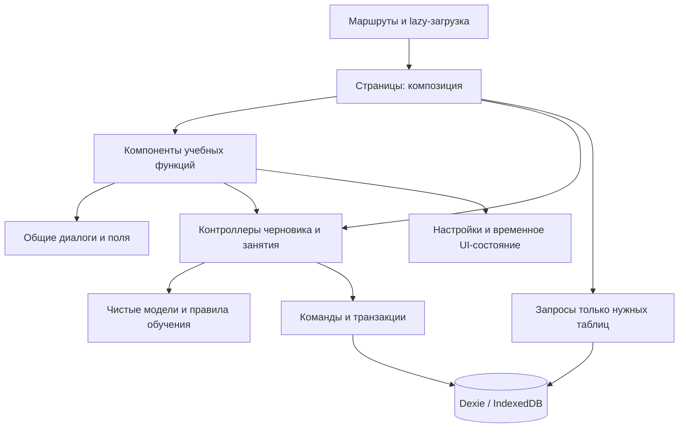

# Архитектурный аудит и рефакторинг Easy Learn

Дата: 21 октября 2026. Проверялась локальная версия проекта в этой рабочей папке. Оценка — инженерное суждение о сопровождаемости, а не формальная сертификация или измерение эффективности обучения.

## Оценка исходного состояния

Общая оценка: **6/10**. У приложения уже был работающий продуктовый фундамент, но быстрые изменения оставили несколько поколений интерфейса, смешанные обязанности и устаревшие проверки. Переписывать приложение целиком или добавлять новый серверный фреймворк для исправления этих проблем не требовалось.

| Область                 | Что было хорошо                                                  | Основная проблема                                                                               |
| ----------------------- | ---------------------------------------------------------------- | ----------------------------------------------------------------------------------------------- |
| Типизация               | Строгий TypeScript, проверка неиспользуемых локальных переменных | Браузерные тесты не проходили TypeScript-проверку                                               |
| Архитектура             | Выделенные функции SRS, проверки ответов и миграции              | Страницы одновременно управляли сохранением, состоянием упражнения и большим JSX                |
| Компоненты              | Общие диалоги, поля, меню, мобильные жесты                       | Недоступный второй редактор колод; повтор редактора допустимых ответов                          |
| Данные                  | Dexie, транзакции публикации и восстановления                    | Каждый `useData()` загружал десять таблиц, даже когда экрану нужна была одна                    |
| Тесты                   | Проверки миграций, идентичности карточек и отката                | Пять старых браузерных сценариев ожидали удалённые элементы интерфейса                          |
| Стили                   | Светлая/тёмная темы, адаптация, reduced motion                   | 14 542 строки SCSS, старые селекторы и повторные объявления после нескольких переделок          |
| Сборка                  | PWA, офлайн-кэш и локальные шрифты                               | Принудительная группировка давала цикл React/database; страницы и графики импортировались сразу |
| Совместимость браузеров | Основной сценарий работал на localhost                           | Безусловный `crypto.randomUUID()` ломал создание записей в локальном HTTP-контексте             |

## Выполненные изменения

### Границы компонентов

- `SetEditorPage`: **856 → 381 строка**. Сценарий редактирования остался на странице; загрузка, очередь автосохранения, сброс таймера, публикация и восстановление вынесены в `features/sets/useSetDraft.ts`.
- `SetCardEditor` управляет одной строкой карточки и подсказками; `SetImportDialog` — только импортом; `editorModel` содержит проверяемое преобразование импорта и перестановку сторон.
- `AnswerAlternatives` используется и редактором колоды, и редактором словаря. Поддержка альтернатив не продублирована в двух формах.
- `SetPage`: **744 → 346 строк**. Превью карточек и его настройки отделены от страницы, диалоги обмена/членства/удаления — от списка и навигации. Превью получает ключ колоды, поэтому его локальный порядок не переносится на другую колоду.
- `Quiz`: **534 → 151 строка**. Управление упражнением находится в `useQuizSession`, конфигурация — в `QuizConfiguration`, подбор пар — в `MatchingAnswers`. Экран результата больше не выполняет запись в эффекте React.
- Условие задачи/решение и сохранённый результат теста находятся в отдельных страницах и загружаются независимо.

Это разделение сделано по обязанностям. Различающиеся учебные экраны не сведены в один универсальный компонент с множеством флагов.

### Данные и бизнес-правила

- `useData` принимает явный список таблиц и подписывается только на него. Например, список игр читает колоды; чтение — тексты и нужные слова; боковая панель — недавние материалы и названия сущностей.
- `useSetData` получает слова конкретной колоды через `bulkGet`, а не загружает весь словарь ради одного набора.
- Создание слов и их идентичность вынесены в чистый `wordModel`; проверка пользовательских языков — в `subjectValidation`, без зависимости от React/store.
- Команды разделены по предметной области: колоды, коллекции, импорт слов, черновики, решения, повторения и резервные копии. Транзакционный CSV-импорт больше не находится внутри модального компонента.
- `assessmentsFor` — единое правило оценки отдельных слов, включая ошибочные пары. Им пользуются сохранение и адаптивная очередь.
- `saveTestAttempt` сохраняет результат и историю ответов **в одной транзакции**. Добавлена проверка принудительной ошибки записи результата: слова, интервалы, история и статистика откатываются вместе.
- Членство колоды в модуле изменяется через проверяемую команду, а не прямое обновление из JSX.
- При перестановке сторон карточки переставляются и допустимые ответы; они не остаются привязаны к противоположному вопросу.
- Индикатор автосохранения не отмечает новую версию сохранённой после завершения более старой записи.
- Удалены неиспользуемые настройки целей и уведомлений. Миграция сохраняет действующие профиль, темы и правила проверки; старые резервные копии продолжают приниматься.

### Удалённый код и зависимости

Подтверждённо недоступные модули:

- `pages/Decks.tsx` и `features/decks/DeckEditor.tsx` — второй, больше не используемый путь создания/редактирования.
- `components/StudyModeCards.tsx` и `features/statistics/WeeklyOverview.tsx` — прежние блоки страниц.
- `services/decks.ts` и его три теста — сохранение только из удалённого редактора. Действующая публикация и её проверки сохранены.
- Неиспользуемый `removeDemo`, пустой файл стилей и устаревшие настройки.
- Старые ручные smoke/vocabulary/clone-preview скрипты, дублирующие актуальные тесты. Снимки объединены в один изолированный скрипт; ручная проверка настоящего YouTube сохранена.

Удалены три прямые зависимости: шрифты Inter/Manrope и Sass. Comfortaa сохранён. Исходные учебные каталоги и данные миграции не удалялись: они нужны генераторам и совместимости старой библиотеки.

Статическая проверка от `src/main.tsx` проходит по **95 модулям**, не находит недостижимых модулей и неиспользуемых именованных экспортов. Это статический анализ импортов, а не обещание распознавать любые будущие вычисляемые пути или внешних потребителей API.

### Стили и сборка

- Сохранён порядок каскада; стили переведены на обычный CSS с понятными именами файлов. Убраны 235 неиспользуемых селекторов и 327 прежних повторных объявлений с одинаковыми условиями.
- Стили сократились с 14 542 до примерно 7 974 строк. CSS production-сборки — **109,13 КБ вместо 130,87 КБ**, около **17% меньше** до gzip.
- Снимки восьми экранов в размерах 1440 и 390 пикселей сопоставлены до/после. 15 снимков побайтно одинаковы. В мобильном прогрессе отличаются 26 пикселей на участке 13×2; размеры страницы одинаковы. Это не заменяет проверку всех состояний и настоящих устройств.
- Страницы загружаются через `React.lazy`; графики не входят в стартовый маршрут. Удалена принудительная конфигурация чанков с циклом React/database.
- Подготовленный каталог загружается компактным JSON-ресурсом и входит в PWA-кэш, вместо превращения большого каталога в исполняемый JavaScript.
- Production-сборка проходит без прежних предупреждений о циклических/слишком крупных JavaScript-чанках. Все части офлайн-приложения по-прежнему кэшируются.
- Добавлены UUIDv4 через `getRandomValues` при отсутствии `randomUUID` и проверка доступности Clipboard API с резервным копированием.

## Текущая схема

Внутри браузерных feature hooks остаются конкретные Dexie-запросы. Это осознанная граница текущего локального приложения. Для облака потребуется отдельный слой синхронизации, а не замена каждой локальной операции сетевым запросом.

## Проверки и воспроизводимость

- `npm run check`: TypeScript приложения и браузерных тестов, недостижимые модули/экспорты, модульные тесты, production/PWA-сборка.
- Модульные проверки: **56**. Три теста удалённого редактора заменены проверками действующего импорта, атомарного результата теста, UUID, альтернатив и миграции настроек.
- `npm run test:e2e:production`: **42 из 42 проверок прошли, без пропусков**, на собранном приложении с настоящим service worker и офлайн-записью.
- GitHub Actions выполняет те же команды на Node.js 22 с фиксированным pnpm; трассировки ошибок сохраняются. Удалённый workflow в этой сессии не запускался.
- `scripts/screenshots.mjs` проверен на изолированной библиотеке и не работает с пользовательским профилем Chrome.

Браузерные проверки охватывают редактор, импорт/изображения/форматирование, восстановление черновика, общие карточки, коллекции, перенос старой немецкой библиотеки, правила ответов, адаптивное занятие, результаты, игры, чтение, видео, резервные копии, мобильные меню/свайпы, темы и офлайн-режим. Видеоплеер в автоматических тестах подменён детерминированной фикстурой.

## Что остаётся ограничением продукта

- Данные локальные: аккаунты, Supabase и межустройственная синхронизация требуют отдельной реализации владения, конфликтов и офлайн-очереди.
- Незавершённый учебный сеанс не восстанавливается после перезагрузки. Это отдельная функция; черновики редактора и завершённые тесты сохраняются.
- Перевод ограничен локальным словарём, озвучивание — возможностями браузера, внешнее видео требует интернета.
- Проверены Chrome и эмуляция узких экранов. Реальные iOS/Safari и физические устройства не проверялись.
- Recharts остаётся на существующей основной версии. Миграция графиков на другую основную версию не смешивалась с сохранением поведения приложения.

Итоговая оценка сопровождаемости локального приложения: **8/10**. Сильнее всего улучшены границы компонентов, целостность записи, объём лишних загрузок, воспроизводимость проверок и отсутствие старых параллельных путей реализации.
